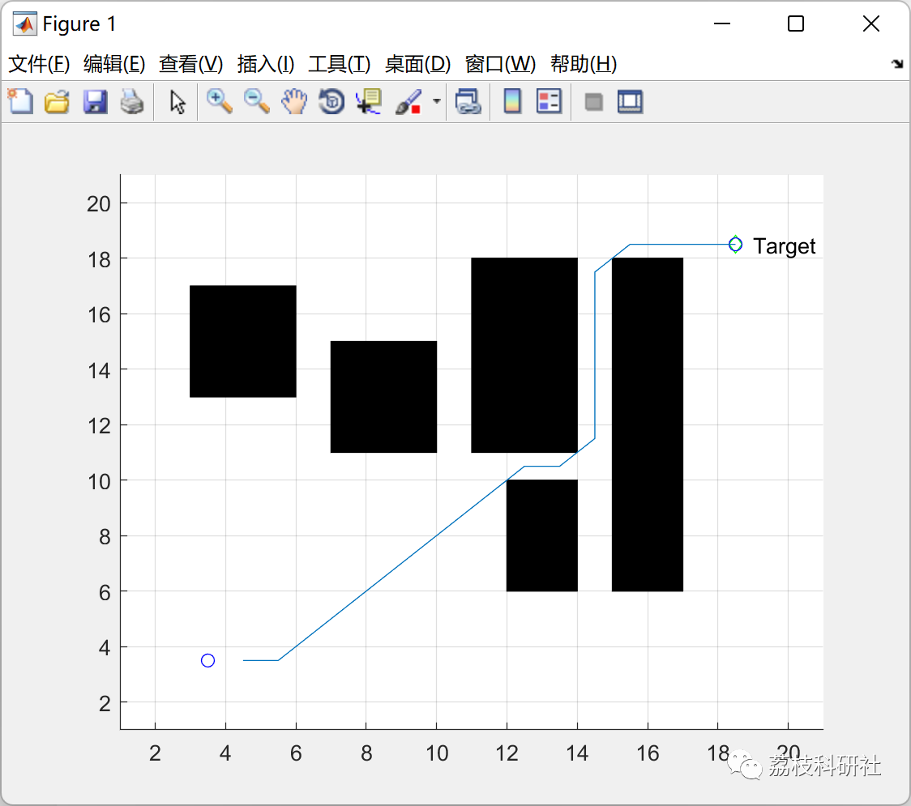

# [Path Optimization] Path Optimization Problem Based on A* Algorithm (Matlab Code Implementation)

💥💥💥💞💞💞 Welcome to this blog❤️❤️❤️ 💥💥💥
🏆 Bloggers' Advantages: 🌞🌞🌞 The content of the blog strives for rigorous thinking and clear logic to facilitate readers.
⛳️ Mantra: A journey of a thousand miles begins with a single step.
Litchi Research Society
Code Collection: Power Systems, Intelligent Algorithms and Applications, Neural Network Prediction, Path Planning, Optimized Scheduling, Workshop Scheduling, Image Processing, Signal Processing...
🎁 Special Section Links:
🌈🌈🌈🌟🌟🌟 Electrical Code Drone and Physical Applications Path Planning Intelligent Algorithms and Their Applications Optimized Scheduling Neural Network Prediction Workshop Scheduling Image Processing Romantic Her Signal Processing Mathematical Modelling My Philosophical Thoughts Complete Code Issues
💥1 Overview
Path planning in mobile robotics is a hot topic in the field of mobile robotics, aiming to plan a safe, collision-free path from the starting point to the target point in an unknown or partially unknown environment.
In known static environments, global path planning algorithms such as grid-based methods, RRT algorithms, A* algorithms, neural network algorithms, genetic algorithms, ant colony algorithms, etc., are commonly used. Literature [1] improved the A* algorithm by incorporating a reverse search mechanism, but its scope remains limited to static obstacle environments. For path planning in dynamic obstacle environments, literature [2] adopted a combination of basic obstacle avoidance strategies and heuristic dynamic programming approaches, but there is almost no research on A* algorithm path planning under obstacles.
📚2 Running Results
👨‍💻4 References
[1] Bian Qiang, Sun Qi, Tong Yude. A Novel Improved A* Algorithm for UAV Three-Dimensional Path Planning [J]. Journal of Wuhan University of Technology, 2022, 44(07): 80-88.
[2] Tao Zhi, Liang Xianxia, Lu Junwei, Zhao Qing. Research on Improved A* Path Planning Algorithm Based on Collision Prediction [J]. Science and Innovation in Technology, 2020(32): 71-73
🎉3 Matlab Code Realization
Click the article's lower left corner to read more.

## Images

<!-- PAYMENT_BLOCK -->

## Get this dataset

- Payment link (Stripe): [Buy now](https://buy.stripe.com/3cs8yP7sY87d0vu9AB)
- Payment QR code: 

<!-- /PAYMENT_BLOCK -->
